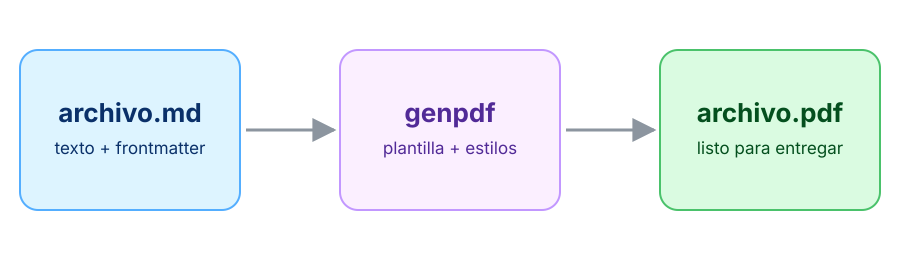

---
# ── Frontmatter ─────────────────────────────────────────────────────────────
# Obligatorios: type y title. Todo lo demás es opcional.
type: deck
title: Plantilla de presentación
author: S4nti4goCoder
date: 2026-10-22
theme: github             # github o default (cualquier .css en genpdf/presentation/themes)
# maxPages: 12            # opcional: aviso y código de salida 1 si se pasa
---
<!--
  Reglas generales:
  - Una línea con solo tres guiones separa un slide del siguiente.
  - <!- - slide: tipo - -> declara el tipo de slide (sin espacios en los guiones).
    Sin declararlo, el primer slide es cover y los demás son bullets.
  - Un párrafo corto justo antes del título (# o ##) es el kicker: el texto pequeño
    en mayúsculas y color de acento que va encima del título.
-->
<!-- slide: cover -->
Kicker de la portada
# Título de la presentación

Subtítulo: una o dos líneas que expliquen de qué va. El autor y la fecha salen del
frontmatter.

---
<!-- slide: cards -->
Slide de tarjetas
## Cada ### es una tarjeta

Un párrafo opcional entre el título y las tarjetas sirve de introducción.

<!-- icon: rocket -->
### Con icono
El comentario icon justo antes del título de la tarjeta elige su icono.

<!-- icon: layers -->
### Colores propios
Cada tarjeta toma un color de acento distinto del tema.

<!-- icon: check -->
### Hasta cuatro
- Caben hasta 4 tarjetas
- Y 3 viñetas por tarjeta

---
<!-- slide: bullets -->
Slide de viñetas
## Una idea por viñeta

- Caben hasta seis viñetas sin desbordar
- Frases cortas, que se lean de un vistazo
- Se puede usar **negrita** y `código`
  - Y viñetas anidadas, que cuentan para el límite
- Las listas numeradas (1. 2. 3.) llevan el número en una insignia

---
<!-- slide: two-columns -->
Slide de dos columnas
## El comentario column separa las columnas

<!-- icon: file -->
### Columna izquierda
- Cada columna es una tarjeta
- Puede empezar con un ### y llevar icono
- Hasta seis viñetas por columna

<!-- column -->
<!-- icon: code -->
### Columna derecha
Acepta cualquier bloque, también código:

```bash
python -m genpdf build mi-charla
```

---
<!-- slide: quote -->
> La cita va en un bloque que empieza con el signo mayor que.

El párrafo después de la cita es la atribución

---
<!-- slide: full-image -->
Slide de imagen
## Con título, la imagen va en un marco



Un párrafo después de la imagen es el pie. Si el slide no tiene título, la imagen ocupa
el slide entero.

---
<!-- slide: closing -->
# Slide de cierre

Título grande, una frase y una lista que se muestra como píldoras.

- Iconos disponibles: los .svg de genpdf/presentation/icons
- Temas: los .css de genpdf/presentation/themes
